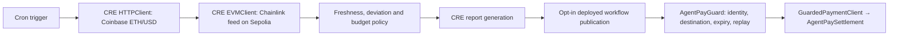

# AgentPay

**Agent payments with deliberate control, orchestrated by Chainlink CRE.**

The CRE Payment Guard fetches a real Coinbase ETH/USD quote, reads a finalized Chainlink ETH/USD feed on Ethereum Sepolia, checks freshness, price deviation and a per-request spending cap, then generates a bounded payment report. A report consumer and TypeScript client connect accepted onchain authorization to one token settlement.

**Successful real CRE CLI simulations:** [ALLOW transcript](docs/evidence/cre-allow.log) · [DENY transcript](docs/evidence/cre-deny-budget.log)

[Submission guide](docs/CRE_SUBMISSION.md) · [Workflow source](cre/payment-guard/main.ts) · [Deployment guide](DEPLOYMENT.md)

## Architecture



The policy uses integer prices and token units. ETH/USD is a market-sanity circuit breaker, not a valuation of the payment token. Reports bind chain, receiver, unique request ID, agent, recipient, token, amount and expiry. The guard trusts a specific forwarder and owner-configured workflow ID. Settlement consumes authorization atomically with token transfer. The SDK checks onchain authority before approval and again before paying.

## Run locally

Use Node.js 22+, npm, Bun 1.2.21+, and the official CRE CLI for simulation.

```sh
npm run install:all
npm run install:cre
npm run dev
```

The dashboard works without a wallet using checked-in evidence. Switch **Within budget** / **Over budget**, inspect observations, download the result, and read its transcript. These are explicitly labeled recorded simulations.

## Why ETH/USD?

This demo is an **oracle-disagreement circuit breaker**: it pauses a payment when an independent API and finalized onchain reference disagree or become stale. It does not value tUSD. An actual USDC policy needs a correctly bound USDC address, token decimals, and a USDC/USD depeg check.

## Reproduce the CRE workflow

Install the [official CRE CLI](https://docs.chain.link/cre/getting-started/cli-installation), then:

```sh
cre login
npm run cre:simulate
npm run cre:simulate -- --deny-budget
```

Equivalent direct command from `cre/`:

```sh
cre workflow simulate payment-guard --target staging-settings --trigger-index 0 --non-interactive
```

Before recording, run `npm run cre:dry-run` to execute both npm scenarios and check ten minutes of freshness headroom. [Recording readiness and optional write demo](docs/RECORDING_READINESS.md) explains backups and the separate simulation-only receiver.

No wallet key or testnet funds are needed for the read-only scenarios. CRE services, Coinbase, and the Sepolia RPC must be reachable. Live inputs can cause denial; the runner fails instead of manufacturing approval. Refresh evidence with `npm run cre:capture` and `npm run cre:capture -- --deny-budget`.

## Verify

```sh
npm test
npm run build:sdk
npm run typecheck:cre
npm run build:web
npm --prefix vite-project run lint
```

Current suites: **99 passing tests** — 27 contracts, 48 SDK, eight middleware, seven CRE policy, nine evidence/tooling checks. CI runs these checks without CRE credentials. Real CLI simulations are separately captured evidence.

## Current scope

- The bounty's simulation path is demonstrated. No workflow is deployed to a live DON, and no public-network payment was sent by these simulations.
- Checked-in payment parties are placeholders, the receiver is zero, and publication is disabled. Evidence JSON is never payment authority.
- Consumer and settlement behavior is separately tested on Hardhat's local network. The simulator's mock forwarder lacks production workflow identity metadata; guard identity checks remain enabled.
- The sample cron configuration represents one payment intent. Real payments need fresh request IDs and real deployment configuration. Duplicate IDs fail closed.
- The spending cap is per request, not a rolling budget, KYC, or compliance service. The deployed workflow configuration and its owner are trusted.
- The original stream tools are separate from guarded settlement. Their illustrative analytics and controls are demo UI. The gateway uses AgentPay-specific HTTP 402 headers, not the full current x402 standard. Unverified transaction hashes are disabled.
- MockUSD (`tUSD`) is an 18-decimal test faucet token with no monetary value. Set your own new deployments through `.env.example` and `vite-project/.env.example`. Chainlink CRE orchestrates the workflow; it is not the payment asset.

Independent project integrating Chainlink technology. [Migration history](MIGRATION.md) and archived `.kiro` specs preserve the original source names and import provenance.
