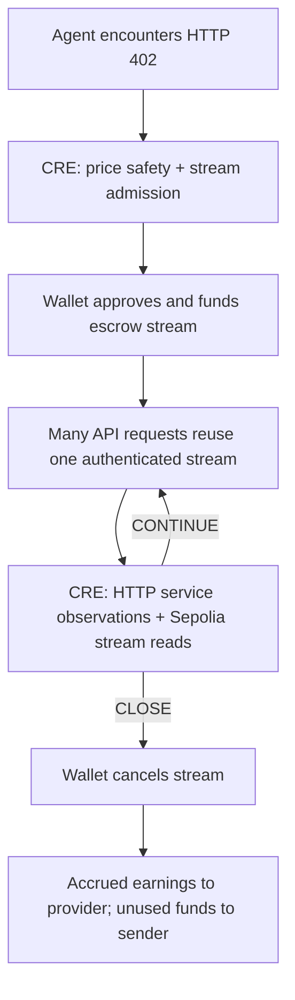

# AgentPay

**Agent payments with deliberate control, orchestrated by Chainlink CRE.**

Paying gas for every API request makes a naive autonomous-agent payment loop expensive. AgentPay started with the N+1 payment problem: how can hundreds of paid requests reuse one funded session? HTTP 402 and x402 inspired a prepaid stream. CRE adds the next layer: decide whether to fund the service, keep using it, or close the stream when observed health fails—and retain an auditable explanation for wallet actions.

AgentPay escrows a session's token deposit and accrues the provider's earnings per second. Many API requests reuse one stream. A local Chainlink CRE workflow reads service observations and Sepolia stream state to decide `OPEN`, `CONTINUE`, `CLOSE` or `DENY`; the agent wallet creates or cancels the stream, paying earned funds and refunding unused escrow.

The AI CLI uses Circle's six-decimal Sepolia USDC. An initial CRE price check compares Coinbase and the finalized Chainlink USDC/USD feed. The service supervisor then ties stream funding and continuation to observed service availability and budget. Workflow deployment to Chainlink's network is outside scope.

**Verified stream demo:** [CRE/agent transcript](docs/evidence/stream-demo/run.log) · [escrow, earnings and refund evidence](docs/evidence/stream-demo/rpc-verification.json).

[AI streaming demo](docs/AI_AGENT_DEMO.md) · [Documentation](docs/README.md) · [Submission guide](docs/CRE_SUBMISSION.md) · [Supervisor source](cre/payment-guard/stream-main.ts) · [Stream contract](contracts/AgentPayStream.sol)



The contract holds the deposit upfront; it does not send a transaction every second. The recipient can withdraw accrued funds, and either party can cancel. Cancellation pays unwithdrawn earnings and refunds the remainder. Expiry makes all remaining funds claimable but does not automatically close or refund a stream. The CLI's provider authenticates the payer's signed session as well as checking onchain state.

## Run locally

Use Node.js 22+, npm, Bun 1.2.21+, and the official CRE CLI for simulation.

```sh
npm run install:all
npm run install:cre
npm run dev
```

The dashboard works without a wallet using checked-in evidence. Switch **Within budget** / **Over budget**, inspect observations, copy its CLI command and read the transcript. These are explicitly labeled recorded simulations. **Agent setup** (`/agent`) validates a local draft and generates SDK code; it does not start an agent or change policy. **Streams** (`/streams`) shows deployment guidance until legacy contracts and a wallet are configured. **Docs** (`/docs`) covers the supported flows in the app. [Agent setup guide](docs/AGENT_SETUP.md).

## USDC payments and USDC/USD policy

The workflow binds Circle’s Sepolia USDC address to Coinbase USDC/USD and the verified Sepolia Chainlink USDC/USD feed. It denies a depeg even when both sources agree, as well as price disagreement, stale data and over-budget requests. [Addresses, units, faucet and policy details](docs/USDC_SEPOLIA.md). Sepolia USDC has no monetary value: the USD reference check models payment-asset risk; it does not give testnet tokens a dollar value.

## Reproduce the CRE workflow

Install the [official CRE CLI](https://docs.chain.link/cre/getting-started/cli-installation), then:

```sh
cre login
npm run cre:simulate
npm run cre:simulate -- --deny-budget
```

The existing wrappers support `--help`, strict option validation and `--json`. For scripts, suppress npm's banner:

```sh
npm run --silent cre:simulate -- --json > result.json
npm run --silent cre:dry-run -- --recording-window 900 --json
```

JSON stdout contains one `{ schemaVersion: 1, ok, command, data }` envelope (or `error: { code, message }` on failure); progress goes to stderr. A completed dry run that is not ready has `ok: false`, `data.ready: false` and exit 1. Expected budget DENY exits 0. Usage/config errors exit 2; execution/verification errors exit 1. Unknown options now fail instead of being ignored. [CLI contracts, compatibility changes and evidence](docs/CLI_AUDIT.md).

Equivalent direct command from `cre/`:

```sh
cre workflow simulate payment-guard --target staging-settings --trigger-index 0 --non-interactive
```

Before recording, run `npm run cre:dry-run` to execute both npm scenarios and check ten minutes of freshness headroom. [Recording readiness and optional write demo](docs/RECORDING_READINESS.md) explains backups and the separate simulation-only receiver.

No wallet key or testnet funds are needed for the read-only scenarios. CRE services, Coinbase, and the Sepolia RPC must be reachable. Live inputs can cause denial; the runner fails instead of manufacturing approval. Refresh evidence with `npm run cre:capture` and `npm run cre:capture -- --deny-budget`.

## Run the AI purchasing agent

The CLI uses actual Qwen/OpenAI tool calls and real local CRE executions. Configure the funded model key, dedicated Sepolia payer, recipient and [verified USDC stream deployment](docs/deployment/usdc-stream.json) using the [AI streaming guide](docs/AI_AGENT_DEMO.md), then preview:

```sh
npm run --silent demo:agent
```

To escrow up to 0.01 test USDC and demonstrate the full lifecycle:

```sh
npm run --silent demo:agent -- --pay
```

The paid demo reuses one stream for ten successful API requests, observes CRE `CONTINUE`, injects three labeled service failures, then obtains `CLOSE` and cancels with verified earnings/refund. Premium proposes a 0.2 deposit against a 0.1 cap and must be denied. Each paid invocation is a new stream and uses test ETH gas. `--verbose` shows model details; `--json` preserves structured output. Recovery uses `--close-stream <id>`.

The CLI displays the exact CRE command, HTTP observations, Sepolia read block, policy limits and transcript paths. [Inspect the recorded CRE work](docs/CRE_SUBMISSION.md#inspect-the-cre-work).

The CLI gates wallet signing on local CRE results. **The stream contract enforces escrow accounting and payouts, not CRE approval**; a payer can call it directly. No DON authentication or closed AgentPayGuard/AgentPaySettlement contract is used. This is an AgentPay HTTP 402 streaming protocol, not full x402. The browser Agent setup remains a local SDK draft, and the browser Streams page retains its separate 18-decimal tUSD deployment.

## Spend reviews and decision receipts

The streaming CLI now dry-runs each business transaction, applies local CRE risk/hard-rule gates, persists its decision to a durable local blob and verifies an onchain inclusion receipt before signing. Denials and errors are retained too. Receipt gas is counted separately; the contract anchors audit hashes and does not enforce CRE approval.

```sh
npm run --silent demo:spend-review
npm run --silent demo:spend-review -- --anchor --resume
```

The first command is unsigned; the second anchors pending decisions using test ETH without transferring USDC. Nine saved decisions—including a genuine stale-feed denial—have verified Sepolia receipts. [Storage, recovery, scope and evidence](docs/SPEND_AUDIT.md).

## ToolBuyer: evaluate quality before choosing a provider

A local CRE workflow buys task-specific trial answers, updates Beta quality beliefs and stops when the expected one-step information value no longer covers trial cost. It compares its held-out results against cheapest-only, fixed-showcase and fixed-expert purchasing, including every trial and answer cost.

```sh
npm run --silent demo:toolbuyer
npm run --silent demo:toolbuyer -- --offline --seeds 17,29,43,71,97
```

The three providers are synthetic; costs debit benchmark credits, not USDC. The default path performs real CRE HTTP trial calls and Sepolia budget reads; `--offline` explicitly uses neither CRE nor the chain. No model key, private key or signing is required. The recorded run beats cheapest-only and the visible-example specialist but loses to fixed-expert purchasing; the myopic stopping failure is documented. [Mechanism, original CRE evidence and full comparison](docs/TOOLBUYER.md).

## Verify

```sh
npm run docs:check
npm test
npm run build:sdk
npm run typecheck:cre
npm run build:web
npm --prefix vite-project run lint
```

Current suites: **174 tests** — 32 contracts, 52 SDK, eight middleware, 31 CRE policy, 51 evidence/CLI/tooling checks. CI runs these checks without CRE credentials, including temporary local RPC deployments; these are separate from live CLI simulation evidence.

`docs:check` verifies local links, compiles documented SDK/UI fragments, and compares original transcript hashes, frontend copies and ABI report fields. [Correctness audit and verification limits](docs/DOCUMENTATION_AUDIT.md).

## Current scope

- The bounty's simulation path is demonstrated. CRE runs locally through the CLI; workflow deployment to a DON and the DON-authorized public USDC payment test are excluded from scope.
- The standalone price/report sample uses placeholder parties, zero receiver and disabled publication. The AI stream runner supplies actual parties and service observations in per-run configs. Evidence JSON is never onchain payment authority.
- Consumer and settlement behavior is separately tested on Hardhat's local network. The simulator's mock forwarder lacks production workflow identity metadata; guard identity checks remain enabled.
- Stream supervisor runs are driven by the local agent at session checkpoints. CRE decisions do not change the stream contract automatically; the wallet executes them. Outage detection cannot reverse already-earned time.
- The spending cap is per request, not a rolling budget, KYC, or compliance service. The local workflow configuration is trusted.
- The original stream tools are separate from guarded settlement. The frontend provides contract setup guidance and a local guarded-payment integration draft; it does not claim live agent telemetry or emergency controls. The gateway uses AgentPay-specific HTTP 402 headers, not the full current x402 standard. Unverified transaction hashes are disabled.
- Guarded payments use [Circle Sepolia USDC](https://developers.circle.com/stablecoins/usdc-contract-addresses), with six decimals and no monetary value. Get test USDC from the [Circle faucet](https://faucet.circle.com/). Legacy streams still use MockUSD (`tUSD`), an 18-decimal test fixture; do not configure USDC in the stream UI or legacy streaming SDK.

Independent project integrating Chainlink technology. [Migration history](MIGRATION.md) and archived `.kiro` specs preserve the original source names and import provenance.
