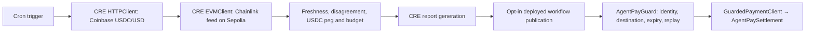

# AgentPay

**Agent payments with deliberate control, orchestrated by Chainlink CRE.**

The CRE Payment Guard fetches a real Coinbase USDC/USD quote, reads a finalized Chainlink USDC/USD feed on Ethereum Sepolia, checks freshness, source disagreement, deviation from the $1 peg and a per-request spending cap, then generates a bounded payment report. A report consumer and TypeScript client connect accepted onchain authorization to one token settlement.

**Successful real CRE CLI simulations:** [ALLOW transcript](docs/evidence/cre-allow.log) · [DENY transcript](docs/evidence/cre-deny-budget.log)

[Documentation](docs/README.md) · [Quick start](docs/getting-started/quick-start.md) · [Submission guide](docs/CRE_SUBMISSION.md) · [Workflow source](cre/payment-guard/main.ts) · [Deployment guide](DEPLOYMENT.md)

## Architecture



The guarded path uses Circle’s six-decimal Sepolia USDC. The policy uses integer prices and raw token units: 0.01 USDC = `10000`, with a 0.1 USDC cap = `100000`. Both price sources must be within 1% of $1 and within 1% of each other. Reports bind chain, receiver, unique request ID, agent, recipient, token, maximum authorized amount and expiry. One settlement may use a positive amount up to that bound; it consumes the entire authorization, including unused headroom. The guard trusts a specific forwarder and owner-configured workflow ID. Settlement consumes authorization atomically with token transfer. The SDK checks onchain authority before approval and again before paying.

## Run locally

Use Node.js 22+, npm, Bun 1.2.21+, and the official CRE CLI for simulation.

```sh
npm run install:all
npm run install:cre
npm run dev
```

The dashboard works without a wallet using checked-in evidence. Switch **Within budget** / **Over budget**, inspect observations, copy its CLI command and read the transcript. These are explicitly labeled recorded simulations. **Agent setup** (`/agent`) validates a local draft and generates SDK code; it does not start an agent or change policy. **Streams** (`/streams`) shows deployment guidance until legacy contracts and a wallet are configured. **Docs** (`/docs`) covers the supported flows in the app. [Agent setup guide](docs/AGENT_SETUP.md).

## USDC payments and USDC/USD policy

The workflow binds Circle’s Sepolia USDC address to Coinbase USDC/USD and the verified Sepolia Chainlink USDC/USD feed. It denies a depeg even when both sources agree, as well as price disagreement, stale data and over-budget requests. [Addresses, units, faucet and policy details](docs/USDC_SEPOLIA.md). Sepolia USDC has no monetary value: the USD reference check models payment-asset risk; it does not give testnet tokens a dollar value.

## Reproduce the CRE workflow

Install the [official CRE CLI](https://docs.chain.link/cre/getting-started/cli-installation), then:

```sh
cre login
npm run cre:simulate
npm run cre:simulate -- --deny-budget
```

Equivalent direct command from `cre/`:

```sh
cre workflow simulate payment-guard --target staging-settings --trigger-index 0 --non-interactive
```

Before recording, run `npm run cre:dry-run` to execute both npm scenarios and check ten minutes of freshness headroom. [Recording readiness and optional write demo](docs/RECORDING_READINESS.md) explains backups and the separate simulation-only receiver.

No wallet key or testnet funds are needed for the read-only scenarios. CRE services, Coinbase, and the Sepolia RPC must be reachable. Live inputs can cause denial; the runner fails instead of manufacturing approval. Refresh evidence with `npm run cre:capture` and `npm run cre:capture -- --deny-budget`.

## Verify

```sh
npm run docs:check
npm test
npm run build:sdk
npm run typecheck:cre
npm run build:web
npm --prefix vite-project run lint
```

Current suites: **111 passing tests** — 29 contracts, 49 SDK, eight middleware, eleven CRE policy, fourteen evidence/tooling checks. CI runs these checks without CRE credentials. Real CLI simulations are separately captured evidence.

`docs:check` verifies local links, compiles documented SDK/UI fragments, and compares original transcript hashes, frontend copies and ABI report fields. [Correctness audit and verification limits](docs/DOCUMENTATION_AUDIT.md).

## Current scope

- The bounty's simulation path is demonstrated. No workflow is deployed to a live DON, and no public-network payment was sent by these simulations.
- Checked-in payment parties are placeholders, the receiver is zero, and publication is disabled. Evidence JSON is never payment authority.
- Consumer and settlement behavior is separately tested on Hardhat's local network. The simulator's mock forwarder lacks production workflow identity metadata; guard identity checks remain enabled.
- The sample cron configuration represents one payment intent. Real payments need fresh request IDs and real deployment configuration. Duplicate IDs fail closed.
- The spending cap is per request, not a rolling budget, KYC, or compliance service. The deployed workflow configuration and its owner are trusted.
- The original stream tools are separate from guarded settlement. The frontend provides contract setup guidance and a local guarded-payment integration draft; it does not claim live agent telemetry or emergency controls. The gateway uses AgentPay-specific HTTP 402 headers, not the full current x402 standard. Unverified transaction hashes are disabled.
- Guarded payments use [Circle Sepolia USDC](https://developers.circle.com/stablecoins/usdc-contract-addresses), with six decimals and no monetary value. Get test USDC from the [Circle faucet](https://faucet.circle.com/). Legacy streams still use MockUSD (`tUSD`), an 18-decimal test fixture; do not configure USDC in the stream UI or legacy streaming SDK.

Independent project integrating Chainlink technology. [Migration history](MIGRATION.md) and archived `.kiro` specs preserve the original source names and import provenance.
