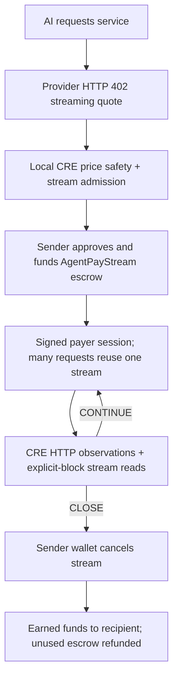

# Architecture and trust boundaries

## Separate reasoning from payment authority

The AI proposes a service request. The host owns the quote and transaction parameters. Local CRE evaluates fixed rules over HTTP observations and onchain state. The CLI validates the result, checks expiry and transaction intent, then signs an eligible action. Reusing the signed active session is CLI/provider behavior; CRE checks the matching stream at lifecycle checkpoints. A CONTINUE result supports that reuse without a new funding decision on every call.

This boundary is designed to reduce financial waste from hallucinated payment instructions. It is not an LLM policy verdict or a guarantee against every loss. Normal checkpoint handling follows deterministic rules; explicit operator recovery cancellation remains available. The stream contract enforces accounting, while the current guardrail is enforced by the CLI.

## Payment lifecycle

AgentPay's current AI demo supervises the original prepaid stream mechanism with local Chainlink CRE. The same AgentPayStream contract is deployed separately for six-decimal Circle USDC and legacy 18-decimal tUSD.

## USDC stream supervision

The [AI runner](../AI_AGENT_DEMO.md) obtains actual model tool calls, but quotes and financial parameters remain host-controlled. A price admission gate uses the [existing USDC workflow](../WORKFLOW.md). The [stream supervisor](../../cre/payment-guard/stream-main.ts) then combines a frozen HTTP observation with wallet/token/stream reads at an explicit recent Sepolia block.

Decisions bind the session, quote, parties, token, stream address/ID, deposit, rate and duration. Provider and client request counters must agree. A healthy admission returns OPEN, a healthy funded checkpoint CONTINUE, and service failure CLOSE. An oversized proposal returns DENY.

The sender wallet signs transactions; the stream contract itself has no CRE authorization hook. Local simulation is single-node and does not establish DON consensus. The demo waits two confirmations for writes, not finality; the separate oracle read uses finalized state. A nonce comparison establishes that service request batches caused no additional wallet transactions.

The provider requires a signed session bound to its origin, quote, chain, payer and stream ID, then verifies the stream before serving each request. The outage scenario is deliberately injected; client/provider counter agreement under one operator is not independent proof of service quality. This is an AgentPay HTTP 402 protocol, not full x402.

The contract is time-based, not per-request metering. It accrues until cancellation is mined, pays unwithdrawn earnings on closure and refunds unearned escrow. At expiry the full remainder is claimable, but no refund transaction runs automatically.

## Strict authorization reference

AgentPayGuard and AgentPaySettlement implement a different one-time settlement example. The guard authenticates forwarder/workflow identity and bounds destination, parties, expiry and replay. GuardedPaymentClient checks that authority before token approval and settlement. The existing public guard remains closed; the AI stream demo does not use these contracts. A simulation result cannot unlock them. [Reference](../contracts/guarded-settlement.md).

## Retained legacy tUSD SDK

The [legacy provider/SDK](x402-protocol.md) still use 18-decimal tUSD and their original [stream lifecycle](payment-streams.md). That gateway checks stream state but lacks payer-bound session authentication; do not confuse it with the new CLI provider. Legacy setup examples are reference material; the current frontend exposes Workflow and Docs.

Both tokens are valueless testnet assets. Rolling onchain budgets, independent service attestation, private execution and multichain settlement are outside this prototype. [Submission and evidence](../CRE_SUBMISSION.md).
