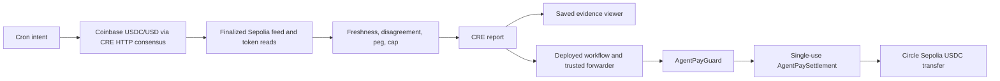

# Architecture and trust boundaries

AgentPay has two explicit payment paths. Only the CRE guarded path is the current bounty orchestration workflow.

## Guarded USDC

- [Workflow](../WORKFLOW.md) joins external and blockchain data, evaluates raw integer values and generates a destination-bound report.
- [AgentPayGuard](../contracts/guarded-settlement.md) trusts its immutable forwarder and owner-bound workflow identity. It checks request identity, parties, destination, amount, expiry and replay. It does not recompute oracle policy.
- [GuardedPaymentClient](../sdk/guarded-payment-client.md) verifies the chain, settlement/guard binding and live authority before approvals and again before settlement.
- The browser evidence viewer shows historical results only. [Agent setup](../AGENT_SETUP.md) saves a local integration draft; it does not operate an agent or publish a policy.

A failed settlement reverts authorization consumption and token transfer together. A denied, expired or consumed report cannot pay. Fresh intents need unique IDs; the fixed sample intent is for read-only reproduction.

## Separate tUSD streaming

The [legacy SDK/provider](x402-protocol.md) negotiates project-specific HTTP 402 headers. It can establish a [MockUSD stream](payment-streams.md) and attach its stream ID on later requests. The provider checks active status, recipient, timestamps and minimum per-second rate. It does not implement an authenticated payer/session binding or durable metering. A public stream ID is not a production access credential.

The gateway rejects direct transaction-hash proof and does not automatically accept guarded settlement receipts. Full current x402 transport/facilitator integration is not shipped. Claimed gas savings/signature counts from old illustrative guides are not measured guarantees.

## Scope

Ethereum Sepolia only. Circle USDC has 6 decimals; legacy tUSD has 18. Testnet tokens have no monetary value. Saved simulation is demonstrated, not live DON deployment or public settlement. The optional mock receiver is record-only. Rolling budgets, KYC/compliance, private execution and multi-chain settlement are not included. This is an unaudited prototype, and workflow configuration/owner are trusted. [Submission](../CRE_SUBMISSION.md).
