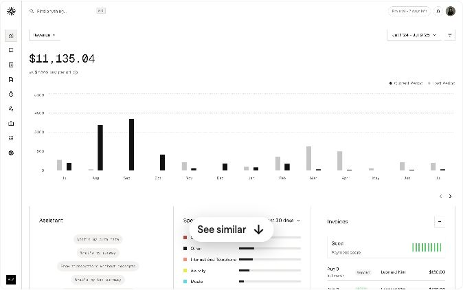
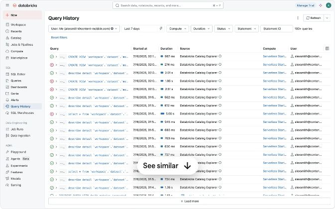
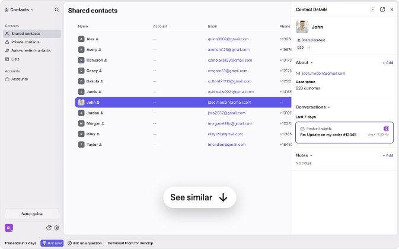
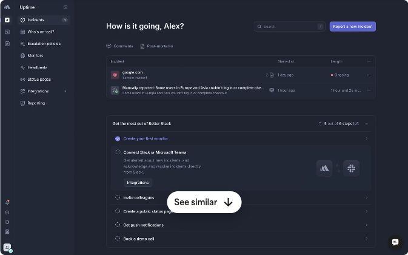
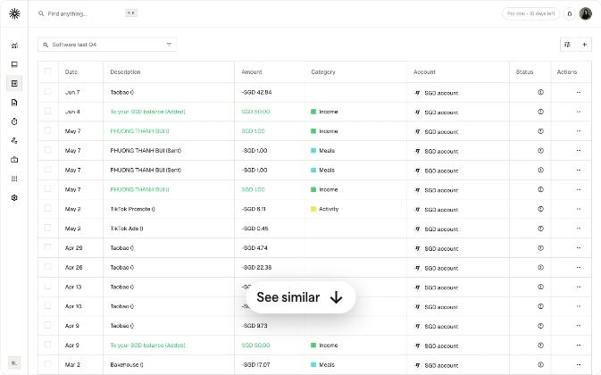
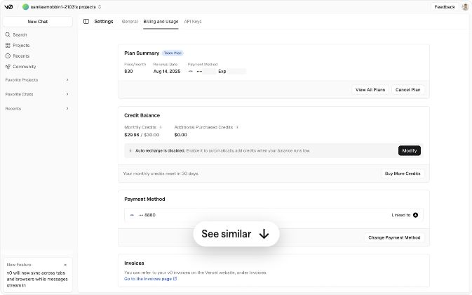
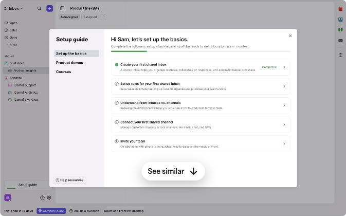
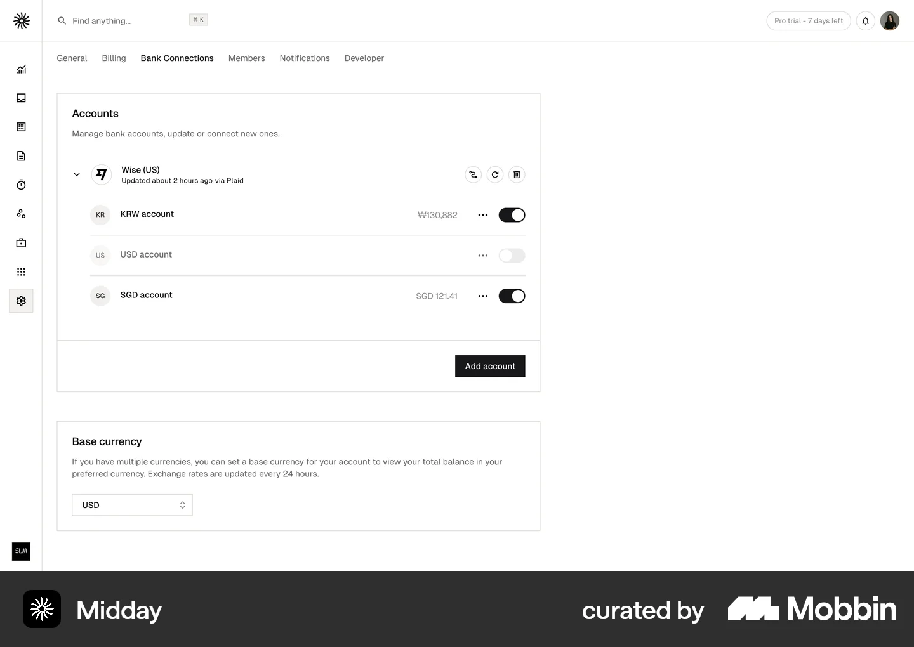

# Mobbin references for AgentPay

Research date: October 27, 2026. Eight public web screens across five products.

This is a design-reference shortlist, not an implementation or a tested end-to-end flow study. Individual public previews were opened and inspected. The browser is signed out; full flow playback, restricted screens, and product behavior behind the screenshots were not verified. No Mobbin integration was available in the connected plugin directory.

[Open the local visual reference board](index.html) · [Source links, observations and image hashes](references.json)

## Recommended direction

Combine Midday’s financial hierarchy, Databricks’ execution history and Front’s detail drawer, with Better Stack’s explicit operational states. The workflow remains the central explanation of how deterministic CRE rules constrain an agent’s payment actions.

Keep the existing Workflow and Docs navigation. Adapt these patterns within that scope; additional bank-product sidebars and a new agent console are not justified by this research.

## Shortlist

| Reference | AgentPay journey | Scope |
| --- | --- | --- |
| [Midday — Dashboard Overview](https://mobbin.com/explore/screens/fa47d11e-0857-4ddc-a515-c837358b7c68) | Understand the money | Current UI |
| [Databricks — Query History](https://mobbin.com/explore/screens/cb7c032f-1b57-4dda-aa57-f458724d6a86) | Inspect a workflow run | Current UI |
| [Front — Contact Details Panel](https://mobbin.com/explore/screens/932fa317-d73d-40fb-b5f6-2db0214bbe38) | Understand a decision | Current UI |
| [Better Stack — Incident Dashboard](https://mobbin.com/explore/screens/1e6425c6-9e2f-43b7-a041-cc6ac778be50) | Respond to service failure | Current UI |
| [Midday — Transaction Table](https://mobbin.com/explore/screens/fa593f08-3e9a-4341-8f56-a407d32b573f) | Trace payment and audit activity | Current UI |
| [v0 — Billing and Usage Settings](https://mobbin.com/explore/screens/109c6bf3-1d25-49f3-98d0-a167f76deaf8) | Read limits without ambiguity | Current UI |
| [Front — Setup Guide Modal](https://mobbin.com/explore/screens/34f46cbf-4653-4101-8658-83a9a7217efc) | Prepare a live agent integration | Future architecture |
| [Midday — Accounts List](https://mobbin.com/explore/screens/8653d2d1-4618-463a-8c5b-713f60457af2) | Manage per-agent vaults | Future architecture |

## Observed patterns and proposed adaptations

### 1. Midday — Dashboard Overview

[Original Mobbin screen](https://mobbin.com/explore/screens/fa47d11e-0857-4ddc-a515-c837358b7c68) · Current UI

**Observed:** A leading monetary total and chart sit above secondary spending and invoice summaries.

**Proposed AgentPay adaptation:** Give funded, earned and refunded USDC clear visual priority beside the workflow. Display observed amounts with their source run.

**Boundary:** A revenue chart is a layout reference; it does not establish AgentPay savings or a live vault balance.

### 2. Databricks — Query History

[Original Mobbin screen](https://mobbin.com/explore/screens/cb7c032f-1b57-4dda-aa57-f458724d6a86) · Current UI

**Observed:** A dense execution table pairs status icons with start time, duration, source and filters.

**Proposed AgentPay adaptation:** Use compact decision rows for action, reason, time, run and execution status. Keep BLOCK and ERROR outcomes discoverable.

**Boundary:** These are query-history screenshots, not observed CRE step playback. A proposed AgentPay row-to-evidence interaction is our adaptation.

### 3. Front — Contact Details Panel

[Original Mobbin screen](https://mobbin.com/explore/screens/932fa317-d73d-40fb-b5f6-2db0214bbe38) · Current UI

**Observed:** A selected list row stays visible beside a right-side details drawer.

**Proposed AgentPay adaptation:** Keep the diagram or decision list in context while showing the selected rule, observed input, bound, decision, permit and receipt evidence.

**Boundary:** The reference contains contact data. Financial fields and decision explanations would come from AgentPay evidence, not from the reference product.

### 4. Better Stack — Incident Dashboard

[Original Mobbin screen](https://mobbin.com/explore/screens/1e6425c6-9e2f-43b7-a041-cc6ac778be50) · Current UI

**Observed:** An incident list exposes service, start time and assignment, with explicit status and setup progress.

**Proposed AgentPay adaptation:** Distinguish service unavailable, CRE unavailable, closure requested, transaction pending and stream closed. Show the last observation time.

**Boundary:** An unavailable provider does not mean accrual already stopped. Continuous monitoring and automatic recovery are not implemented.

### 5. Midday — Transaction Table

[Original Mobbin screen](https://mobbin.com/explore/screens/fa593f08-3e9a-4341-8f56-a407d32b573f) · Current UI

**Observed:** A searchable transaction table separates date, description, amount, category, account and status.

**Proposed AgentPay adaptation:** Separate stream funding, recipient earnings, refunds and receipt gas. Link transaction hashes to their actual operations. Keep blocked decisions visible without inventing payment transactions.

**Boundary:** A confirmed audit receipt anchors a record; it is not a completed payment. This is not a request to add an accounting product.

### 6. v0 — Billing and Usage Settings

[Original Mobbin screen](https://mobbin.com/explore/screens/109c6bf3-1d25-49f3-98d0-a167f76deaf8) · Current UI

**Observed:** Plan, credit balance, recharge setting, payment method and invoices are grouped into separate cards.

**Proposed AgentPay adaptation:** Separate available funds, workflow limits and contract limits, with asset units and reset scope. In the current deployment, the contract deposit cap is 0.01 USDC while the registered workflow cap is 0.1 USDC.

**Boundary:** The source is billing presentation, not a verified spending-policy editor. AgentPay has no rolling daily onchain budget yet.

### 7. Front — Setup Guide Modal

[Original Mobbin screen](https://mobbin.com/explore/screens/34f46cbf-4653-4101-8658-83a9a7217efc) · Future architecture

**Observed:** A setup guide groups tasks into a checklist with a progress indicator and a completed item.

**Proposed AgentPay adaptation:** Use explicit prerequisites for registered agent, matching policy authority, USDC, gas, CRE authentication and recovery readiness. Keep credential-free replay available separately.

**Boundary:** A new operator cannot currently provision a fresh deployment through a complete supported onboarding flow. No setup UI was implemented in this research pass.

### 8. Midday — Accounts List

[Original Mobbin screen](https://mobbin.com/explore/screens/8653d2d1-4618-463a-8c5b-713f60457af2) · Future architecture

**Observed:** Connected bank accounts are grouped by institution, with individual account rows, balances and an add-account action.

**Proposed AgentPay adaptation:** After guarded vaults exist, group an agent identity with its vault address, USDC balance, committed funds, allowed services and authority status.

**Boundary:** AgentPay currently has one agent-bound stream escrow, not automatically provisioned per-agent vaults. The source does not demonstrate crypto funding or vault custody.

## AgentPay journey to design next

1. **Choose replay or live execution.** Explain prerequisites before the primary action. Recorded mode shows its capture date; live mode shows actual runner readiness.
2. **Understand the permitted action.** Present the agent, provider, USDC amount, duration, applicable limits and enforcement authority. Any proposed editing control needs a supported configuration and validation path first.
3. **Follow the lifecycle.** Keep the funding edge visible. Distinguish a proposed action, a deterministic decision, an issued signature, a submitted transaction and a confirmed state.
4. **Inspect the evidence.** A selected decision should expose the observed value, threshold, reason and original artifact. A blocked decision may have an audit receipt without a payment transaction.
5. **Understand closure or recovery.** Show observed recipient earnings and returned escrow separately. Explain who must act if CRE is unavailable; do not show a stream as closed before confirmation.

These are proposed journeys to validate in design; the screenshots do not establish their usability. A future multi-agent vault flow additionally needs the actual vault, provisioning, budget and authority mechanisms described in the [architecture](../../architecture/README.md) and [guarded-stream guide](../../GUARDED_STREAMS.md).

## Evidence and reuse

Links identify the exact public Mobbin pages inspected. The JSON separates observed layout from proposed adaptation and records SHA-256 image hashes. Reference imagery belongs to the original products and Mobbin; retain attribution and use it as research material, not as AgentPay product artwork. Some browser crops retain Mobbin’s “See similar” overlay; that control is not part of the referenced application.

No screenshots establish a product’s contract guarantees, measured conversion improvement, x402 compatibility or financial safety. No agent keys, wallet balances or private project artifacts were uploaded to Mobbin.
